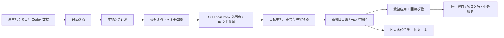

# Codex Workspace Bridge — SPEC 0.1

状态：首个可运行社区版本；Python 3.11+；MIT。2026-10-26。

## 1. 要解决的问题

把开发主机从一台个人电脑迁到另一台，旧电脑继续作为远程输入、交互和演示端。迁移不仅是搬目录：未提交文件、Git 对象与工作树、业务数据库、运行依赖、应用项目登记、聊天上下文、附件、Goal、扩展和账户登录分别属于不同的状态域。某一域通过，不得代替其他域的通过。

第一用户是不了解 Git 与本地应用数据结构的个人开发者。程序应提供可读清单、可点选计划、可复验迁移包和可回退恢复；专家能够用 CLI 自动化。AI Skill 解释和编排，数据改写由可审计代码执行。

## 2. 从真实迁移提取出的流程

| 阶段 | 实际问题 | 固化要求 |
|---|---|---|
| 确认执行主机 | 本机、远程桌面、远程 App 执行器容易混淆 | 每次输出记录 OS、主机与路径；不能以截图里的用户名推断当前命令主机 |
| 第一轮盘点 | 40 个工作区有修改/未跟踪；26 个 Git 目录尚无首次提交 | 无 Git、未首次提交、未推送、脏工作区分别显示；禁止先清理 |
| 第二轮盘点 | 单个仓库挂接数十个工作树 | 同时记录 common Git directory、worktree、refs、HEAD、工作状态 |
| 存储分层 | 内置 SSD 容量受限，外置机械盘承担资料与容量扩展 | SSD/HDD/跳过由项目点选；依赖可重建；大数据需业务一致性方案 |
| 建立通道 | SSH 未开、首次主机指纹、DHCP 多次变更、后来不在同网段 | 传输与数据格式解耦；支持把包交给 SSH、AirDrop、共享或远程工具；不自动开放公网端口 |
| 文件迁移 | 源项目还在开发，复制过程中会变化 | 首轮复制后必须做增量；变化/冲突单独报告，目标新增工作优先保全 |
| 环境重建 | 旧虚拟环境、原生模块、默认 Node 版本不能直接假定可用 | 按锁文件重建并做项目原有测试；不能以目录存在判定能运行 |
| App 登记 | 后端列表出现不等于用户界面出现 | 必须打开实际目录，确认主机，检查项目下原聊天 |
| 聊天恢复 | 工程复制完，项目侧栏仍“暂无聊天” | 索引、轮次、消息、子聊天、rollout、归档状态、图片分别核对 |
| Goal 补恢复 | 聊天恢复了，Goal 仍消失 | Goal 是独立状态域；保留 ID、全文、预算、累计用量与时间；恢复为暂停 |
| 冷恢复与重启 | 写入数据库成功，界面仍用旧缓存 | 数据校验、App 重启、原生界面抽查分开报告 |
| 数据库最终切换 | 大型数据库继续写入；切换会中断服务 | 获准服务窗口→停止写入→一致性快照→双位置校验→目标恢复→业务验收→切换 |
| 安全暂停 | 用户离网，最终切换尚未完成 | 保留候选与原件，恢复源服务（如已约定），写清下次增量起点 |

这次案例完成了 123 条普通聊天的恢复，以及 20 条关联 Goal 的补恢复。Goal 界面实际抽查了 3 条；大型业务库最终切换仍暂停。以上是案例复盘，不是本程序对任意版本 App 的兼容性证明。真实项目名、聊天正文、主机地址和私有迁移回执不进入公开仓库。

## 3. 产品形态与边界

选择 **无第三方运行依赖的本地 CLI + 离线 HTML 点选界面 + Codex Skill**。不需要 API Key、不建立云端账户、不上传清单、不发模型消息、不启动任何 Goal。当前不提供 MCP 远程写入端点，减少不必要的凭据与权限面。

v0.1 提供完整的“盘点→计划→打包→传输→差异预览→只追加恢复→校验”文件流程，并提供实验性的三库聊天/Goal 冷恢复、准备区、提交日志、第二备份位置与回滚。传输由用户已有受信任工具完成；程序不操控其账户或打开网络服务。

运行数据库、Docker、插件重装、MCP OAuth、官方交接与最终服务切换由 RUNBOOK 和 Skill 引导，不在 v0.1 自动执行。外置盘格式化、删除原项目、向 GitHub 推送私人项目、恢复定时任务均不是隐含动作。

## 4. 组件与数据流

公开程序仓库与私人迁移包是两个独立目录。程序的测试只用合成数据。

### 文件格式

- `workbridge.inventory/v1`：主机、项目、体积、Git 状态、运行清单、错误。
- `workbridge.plan/v1`：稳定项目 ID、源目录、SSD/HDD/review/skip、排除规则。
- `workbridge.bundle/v1`：每个目录/文件/符号链接、POSIX 基本模式、文件 SHA256、来源和 Git 关系。
- `workbridge.diff/v1`：add/same/conflict；不将目标多出的文件视为应删除。
- `workbridge.profile/v1`：三库快照、会话文件、内置生成图片、原 Goal 状态、逐文件哈希。
- `workbridge.profile-commit/v1`：目标前像摘要、准备内容摘要、只新增文件、表级增加计数、路径映射。
- `write-N.json` / `receipt.json`：写前日志、提交状态与第二备份位置。掉电后不得自动当作完整成功。

哈希绑定被审核的输入和准备结果，不提供来源签名或对抗已控制本机攻击者的认证能力。

## 5. 文件与 Git 规则

1. 不执行项目代码、Git hook、依赖安装、fetch、pull、checkout、reset、prune。
2. Git 命令关闭可选索引写锁与 fsmonitor，禁止交互式认证。
3. 发现 `.git` 文件时必须确认 common directory 也属于选中单元。复制后的绝对链接另以显式映射修复；源 `.git` 不动。
4. 打包逐文件哈希，复制后回读；结束时复查文件元数据和 Git 状态。它不能代替停止数据库写入，也不能证明所有文件属于同一业务事务。
5. 恢复先全量预检。任何已有不同内容/模式均停止，不自动覆盖。只新增缺失项目文件，允许相同内容的幂等重复。
6. 为避免同名项目碰撞，目标目录使用 `名称--稳定ID`。用户若希望改名，应先编辑明确的恢复方案，不能用软链接伪装主机路径。
7. 发现路径穿越、大小写/Unicode 冲突、特殊文件或导入链接作为父目录时停止。
8. v0.1 不保留 ACL、扩展属性、resource fork 与硬链接身份；对依赖这些元数据的工程使用 macOS 原生保全工具并独立验收。

默认排除常见依赖/缓存和私密凭据文件名；不保证发现所有秘密。Git 历史和普通文件仍可能含秘密，因此迁移包始终按私人数据处理，不可直接放到公开仓库。

## 6. 聊天与 Goal 适配器

### 适用条件

当前适配 `state_5.sqlite`、`thread_history_1.sqlite`、`goals_1.sqlite` 这一布局。源/目标完整 SQLite schema 必须一致；源 Goal 字段集必须匹配。数据库触发器、view、virtual table、未支持的无主键表均拒绝。名称一致不等于所有 App 版本已支持。

官方 App Server 文档提供 `thread/read`、`thread/turns/list`、`thread/items/list`、`thread/goal/get` 等接口，但本项目使用的本地冷库合并不是官方导入协议。先尝试当前产品可用的官方交接；如果因草稿保护被阻止，不清空或发送草稿来绕过。

### 快照与合并

- 源与目标都应停止使用该 profile 的 App、CLI、远程执行器；参数 `--app-stopped` 是操作者声明，程序另检查当前用户默认 profile 的常见 App/app-server 进程。自定义 profile、其他主机和其他运行器不能仅靠本机进程检查证明已停。
- SQLite backup API 读取已提交状态；完整性检查后生成私有快照。仅保留列出的聊天/项目表与迁移 schema 表；删去快照内的 enrollment、任务控制表行，并 VACUUM 清除自由页旧内容。
- 认证库、队列、日志、自动化、插件/MCP 凭据不迁入。
- 导出原 Goal 状态供审计；所有待导入 Goal 为 paused。目标既有不同 Goal 或聊天行一律报冲突，不覆盖其状态和累计量。
- 待导入聊天收紧为只读 sandbox 与重新审批，关闭自动执行开关。用户后续按需要重新授予权限。
- 只对明确的路径字段做前缀映射，不批量替换聊天正文、历史命令或目标全文。rollout 必须在目标或准备区可解析；缺失时停止。
- 只追加表行，所有目标旧行及未列出的目标表保持不变。UI 只合并白名单项目相关键；标量冲突停止，不替换草稿/一般设置。
- 完整保留 profile 内 sessions、archived_sessions 与 generated_images。外部附件、压缩缓存内路径、历史临时图片和 Markdown 绝对链接不宣称自动修复，须单独补齐和验收。

### 提交与回退

准备阶段不写目标内容。提交要求计划 SHA256、冷窗口声明、目标未漂移、准备文件未被改动，以及第二备份位置。备份必须回读一致。

跨数据库采用写前日志和逐文件原子替换，**不是跨多文件的硬件原子事务**。掉电中断通过 `profile-rollback` 回退；后像另存，不删除。若目标在提交后被用户修改，回滚停止，保留两份供人工判断。第二位置是否不同文件系统会记录；程序不能据此证明是另一块物理磁盘或异地备份。

数据库提交成功只算数据层完成，结果必须保留 `gui_verified=false`，直至操作者另行完成 App 重启与原聊天界面检查。程序不自动点击 Goal 的继续按钮。

## 7. 配置、运行数据与存储分层

| 内容 | 默认建议 | 验收 |
|---|---|---|
| 活跃代码、Git、索引、数据库热数据 | SSD | Git、依赖、原测试、访问速度 |
| 大型媒体、研究原始资料、冷数据 | 外置数据盘 | 哈希、权限、路径、断盘行为 |
| 可重建依赖与缓存 | 按锁文件重建 | 版本、native ABI、原项目测试 |
| Docker image | 优先重建；必要时离线导出 | 架构与版本 |
| Docker volume、bind mount | 独立一致性备份 | 隔离恢复与数据查询；不自动启动 |
| Skills、模板、工程指南 | 显式列清单，单独安装 | 文件、发现、真实调用 |
| MCP、插件配置 | 迁配置结构，凭据重新登录 | 工具发现、只读调用、UI |
| App / Codex 对话与 Goal | 单独私有快照与适配恢复 | 索引、正文、归档、附件、卡片 |
| SSH/GitHub/API 身份 | 不默认复制凭据 | 新主机重新认证、最小授权 |

同一块外置盘上的工作资料和其同盘副本，只是容量分层和历史保全，不能当作独立备份。长远建议至少有另一个物理或离线/异地副本。MacBook 仅作远程终端时，不把复制一份离线演示工程作为强制门槛。

## 8. 失败、暂停与验收

拒绝时给出具体冲突，不运行自动修复循环。源机器仍是保全原件；迁移增量候选不是正式业务库。允许分域暂停；状态不能仅有“完成/失败”两个总开关。

发布前必须通过：文件 roundtrip、相同包幂等、目标冲突不覆盖、包体损坏、路径穿越、链接父目录、Git 初始/多工作树、源扫描漂移、HTML 注入、三库添加合并、权限收紧、Goal 暂停/累计量、旧目标身份保留、schema 冲突、孤儿 Goal、rollout 缺失、准备区篡改、提交中断日志和不覆盖用户新改动的回滚。

程序首发用合成 profile 测试。生产案例经历的是本程序之前的专用迁移脚本，不可把那次验收移作本程序的新生产验收。macOS 是当前实测平台；Linux/其他 App 布局需各自的 CI 和真实 profile 验收。

## 9. 后续扩展

- 只读官方 App Server 连接器：分页拉取项目/聊天/Goal 与停止状态，避免依赖 UI 猜测。
- 经版本 fixture 验证的更完整 App store adapter、压缩 history-base 闭包与外部附件绑定。
- 基于三方基线的增量冲突处理；不将双向同步等同于一次迁移。
- 数据库逻辑导出、Docker 卷和运行服务切换的专用适配器。
- 签名发行包和更多平台测试；验证稳定后才提供更高权限的 MCP 插件。

## 官方依据

[Codex App Server API overview](https://learn.chatgpt.com/docs/app-server#api-overview)，2026-10-26 查阅。文档支持官方 thread/Goal 读取接口的存在；不为本项目私有 SQLite 布局或跨机器恢复提供稳定性承诺。
